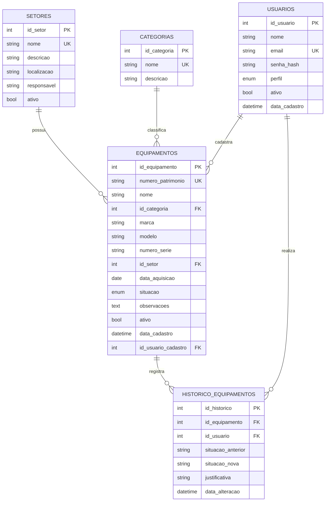

# Diagrama Entidade-Relacionamento (DER)

Cole o bloco abaixo em https://mermaid.live (ou veja no GitHub, que renderiza automaticamente).
Para o DER formal do MySQL, use o **MySQL Workbench**: *Database → Reverse Engineer* sobre o banco `equipamentos_db` e depois *File → Export → PNG/PDF*.

